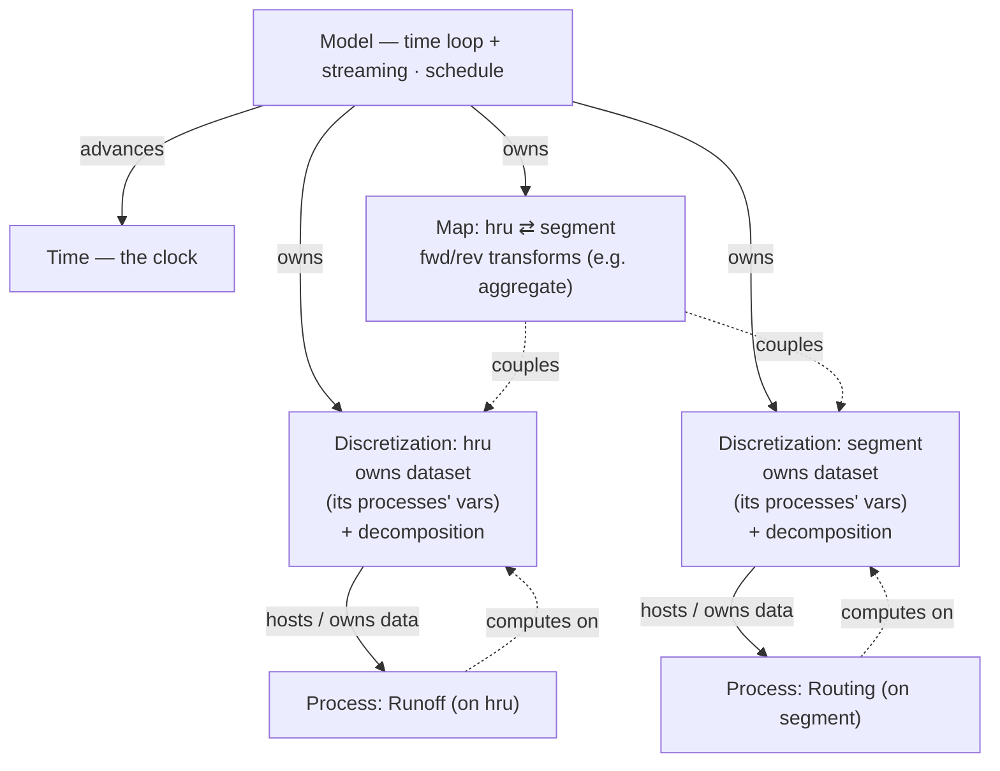

<!-- START doctoc generated TOC please keep comment here to allow auto update -->
<!-- DON'T EDIT THIS SECTION, INSTEAD RE-RUN doctoc TO UPDATE -->

- [Some general ground rules](#some-general-ground-rules)
- [Project context](#project-context)
- [Environment (tests and tooling)](#environment-tests-and-tooling)
- [python assumptions/conventions](#python-assumptionsconventions)
- [Prime directive: memory](#prime-directive-memory)
- [pws_phoenix package design notes](#pws_phoenix-package-design-notes)
  - [Core decision: discretization = the unit of decomposition](#core-decision-discretization--the-unit-of-decomposition)
  - [Variable taxonomy: parameters vs inputs (by relationship to model time)](#variable-taxonomy-parameters-vs-inputs-by-relationship-to-model-time)
  - [Serial path (`Model` in `model.py`)](#serial-path-model-in-modelpy)
  - [MPI path (`ModelMPI` in `model.py`) — single-decomposition streaming](#mpi-path-modelmpi-in-modelpy--single-decomposition-streaming)
  - [Known mpixarray limits (Phase 1)](#known-mpixarray-limits-phase-1)
  - [IO is intentionally NOT apples-to-apples](#io-is-intentionally-not-apples-to-apples)
  - [Global state: `Time` + `Options` (the "Global" split)](#global-state-time--options-the-global-split)
  - [Units mode (Nov 2026; stages 1 + 2 built, stage 3 piloted)](#units-mode-nov-2026-stages-1--2-built-stage-3-piloted)
  - [Phase 2 backlog (separable, layered on top)](#phase-2-backlog-separable-layered-on-top)
  - [Porting pywatershed processes (goal 4; started July 2026)](#porting-pywatershed-processes-goal-4-started-july-2026)
  - [FlowGraph port: agreed design (July 2026; Stage 1 BUILT + green)](#flowgraph-port-agreed-design-july-2026-stage-1-built--green)
  - [Container-model unification (implemented)](#container-model-unification-implemented)
  - [Object model & serial vs MPI](#object-model--serial-vs-mpi)
  - [Forward design (June 2026 discussion): structure, schedule, open topics](#forward-design-june-2026-discussion-structure-schedule-open-topics)
  - [Build plan: multi-grid, incremental (June 2026)](#build-plan-multi-grid-incremental-june-2026)
  - [Input structuring: serial vs MPI, multi-file / datatree (June 2026)](#input-structuring-serial-vs-mpi-multi-file--datatree-june-2026)
  - [Prior art: xarray-simlab & Landlab (from the retired xr design summary, Apr 2026)](#prior-art-xarray-simlab--landlab-from-the-retired-xr-design-summary-apr-2026)

<!-- END doctoc generated TOC please keep comment here to allow auto update -->

Hi Claude,

# Some general ground rules

0. Never look at files in directories above the directory containin this file
   (this is the "project" directory).
1. Never run git. Never run any git commands that edit history or remove
   uncommitted files. If you want to run "git diff", please ask first.
2. Do not run any code without my explicit permission. I generally like to run
   codes and copy and paste the result to you. There can be exceptions but you
   must ask permission.
3. Before you make very many edits, I like to have a plan that you and I have
   worked out. I like to discuss the plan with you and to be certain of the
   plan before having you make many edits. Please check in with me if anything
   is not clear, you cant find something, or your're unsure what I'm talking
   about. It is always best for you to check in with me!
4. Number 3 above applies at any point in our work. If there is an issue and
   I suggest something, I want you to discuss with me and not rush off trying
   to fix it (unless it's less than about 10 lines of code).
5. I want you to default to SHORT summaries. I'd like a
   concise summary from you directly and it would be nice to ask if i'd like
   additional detail with the summary. Please do not cretae summary files
   without explicit permission.
6. I want you to ask for permission before spawning additional and/or parallel
   agents. I want to be sure the overhead is justified before hand.
7. Use precise, non-jargony language -- to the point of showing code rather
   than describing it. E.g. instead of "the `indices` parameter is shadowed",
   quote the two offending lines. Prefer plain statements over idiom:
   "the read-driven mode is what pws_phoenix uses", not "the read-driven
   mode is the load-bearing path for us". Spell out names ("mpix_meta",
   not "meta-root").

I'm looking forward to working with you, this will be fun. Please give a quick
acknowledgement of these ground rules before we start. Thank you!

# Project context

`pws_phoenix` is a rewrite of pywatershed, a physically-based hydrological model.

The goals of the rewrite are to:

1. integrate closely with the xarray dataset model
2. improve performance as much as possible. to that end
   a. integrate with the mpixarray package
   b. leverage numba to the fullest extent possible
   c. optimize IO, particularly output
   d. explore vectorization
   e. focus on accelerating the embarassingly parallel nature of (non-cascading)
   HRUS to start.
3. Use numpy refs underlying xarray to the fullest extent to keep the memory
   footprint low
4. Provide a reasonable pathway to port existing pywatershed concrete Process
   implementations into pws_phoenix.

More design design considerations are writen down in the top-level README.md,
please read that.

Explicitly solved hydrologic models like `pws_phoenix` advances one timestep at a time (Markov dependency via `var_previous`). The spatial dimension is typically an unstructured vector (HRUs), occasionally 2D (x,y). Time × space is therefore the natural chunking shape for scaling studies.

If additional context arises about this project which is useful to add, please let me know

# Environment (tests and tooling)

The env of record is **`pwpx`**, built from `pws_phoenix/environment.yaml`
(July 2026; previously the meta-repo `mpix` env was used by habit). ONE
parallel env: the MPI + parallel-IO stack rides in the yaml's marked
`BEGIN/END parallel-io` block (delete the block = the serial derivation;
CI's Windows job does this). The mpixarray ecosystem is pip-installed
into it in dependency order (see README Installation) -- **mpixarray
branch `1.0.0`, mpix `main`** (Oct 2026; the old `pws` branch API is
gone). `pwpx` has
everything: pytest (+-mpi), mypy, ruff, and the pywatershed import-chain
deps for the parity tests (pywatershed itself is used from the mpix-root
clone via sys.path). Test data = the pywatershed clone's `test_data/`,
populated + derived from the pws-prms-oracle by pywatershed's
`oracle_populate.py` (Oct 2026); `PWS_TEST_DATA` overrides the root
(`tests/conftest.py`); answer keys are PINNED in
`tests/prms_oracle.toml` (macos-arm64 only so far) and checked at
session start -- a regenerated oracle = a reviewed key bump, never a
silent shift. Run tests from the repo root:
`./tests/run_tests.sh` (serial + MPI, no skips allowed;
`--serial-only` / `--parallel-only` for one half).

# python assumptions/conventions

1. please use pyton 3.14 syntax, particularly for typehinting.
2. Please read the ruff.toml for line length setting.
3. Avoid single-letter variable names. For throwaway loop variables, prefer doubled letters, e.g. `cc` instead of `c`, `kk` instead of `k`.
4. Example notebooks are py:percent `.py` files written for USERS —
   follow `.claude/skills/notebooks/SKILL.md` (format mechanics, the
   required how-to-open header, and the pywatershed-numbered-notebook
   tone) whenever writing or editing anything under an `examples/`
   directory.
5. Every float `DataArrayMeta` declares `units=` from the closed
   vocabulary in `pws_phoenix/units.py` (int/bool fields may omit it);
   `tests/test_units.py` enforces it. A new unit = a new key in that
   table with its pint expression (`None` if pint cannot express it).
   FlowGraph fields in the graph's io units declare the placeholders
   `io flow units` / `io flow units x s` / `io storage units`,
   resolved at composition.

# Prime directive: memory

Keep the memory footprint lean and OBVIOUS. Concretely:

1. Reference, don't copy: an array handed to the framework (process_dict,
   Input, Map, Output) IS the working buffer. Never deepcopy anything
   that can hold data -- copy structure only (e.g. a two-level dict copy).
2. Every allocation must be one of: (a) model state, allocated once at
   assembly; (b) a declared, reused per-step window buffer
   (Input.current_values, Map.target_values, Output chunk buffers);
   (c) a temporary inside a numba kernel. Anything else is a bug, or
   carries a comment justifying it.
3. Watch for hidden copies and call them out in review: deepcopy,
   np.asarray/astype on existing arrays, fancy indexing, xarray ops that
   materialize (selection on lazy datasets -- see test_ref_behaviors.py).
4. The same principle in TIME: a process holds its fields' ndarray
   references and never does `self._obj[name].values` inside a step
   (`xr.Dataset.__getitem__` builds a DataArray per call, ~8-20 us; the
   lookups were measured at 82-99% of every process step). Implemented
   Oct 2026 as `Process._refs` (captured once at bind; `refs[name]` in
   every step method) -- `DEVELOPER.md` "Per-step data access"
   has the numbers, the one-ndarray-per-name invariant (serial and MPI)
   and the rules it imposes.

# pws_phoenix package design notes

These notes hold the RULES and the current mechanics. The reasons
behind each design are in `docs/design_description.md` (one entry per
design, with a table of them at the top). Port detail is in
`docs/PORTS.md`, known hazards in `docs/MAINTENANCE.md`, performance
rules in `DEVELOPER.md`.

The package `pws_phoenix/pws_phoenix/`:

- `clock.py`: `Time`.
- `data_io.py`: serial IO (`Input`, `Output`).
- `discretization.py`: `Discretization`.
- `maps.py`: `Map`, `MapMPI`.
- `process.py`: `DataArrayMeta` and the `Process` ABC.
- `model.py`: `Model` (serial) and `ModelMPI` (streaming).
- `config.py`: a minimal yaml -> `(process_dict, control, maps,
  discretizations)` loader.
- `budget.py`, `units.py`, `flow_graph.py`, `flow_graph_build.py`,
  `model_contract_graph.py`.
- `processes_concrete.py`: the toy Upper / Lower processes.
- `hydrology/`, `atmosphere/`: the pywatershed process ports, one
  process per module.
- `prms_translate/`: PRMS files -> model inputs. The core never
  imports it.

Import order: `model.py` is the top (it imports `data_io`,
`discretization`, `clock`, `process`); `config.py` sits beside it;
`maps.py` is foundational (numpy and xarray only); `process.py`
imports only `clock.py`.

## Object model

Reasons: `docs/design_description.md` "One shared dataset per grid,
the same structure in serial and MPI".

- The discretization (grid) is the unit of MPI decomposition. It owns
  ONE shared `xr.Dataset` holding every variable of its processes.
- Buffer sharing is STRUCTURAL: a same-named variable is added to a
  grid's dataset once, so processes that name it share it
  (`param_shared_name`, `Upper.flow -> Lower.flow`).
- The dataset is flat, not a DataTree. Two processes on one grid
  cannot each have a private variable of the same name: same names
  share, silently (a collision check is on the backlog).
- A process binds directly to its grid's dataset (`cls(grid_ds)`). It
  cannot tell a serial dataset from one rank's block.
- A serial run uses no MPI and no mpixarray. The two paths differ
  only inside `Discretization` and in the Model's run loop (the table
  below).
- `Discretization` is one uniform class, with no subclasses and no
  registry. Its identity is its key in the Model's `discretizations`
  dict.
- `finalize` RELEASES EXTERNAL RESOURCES; it does not delete data.
  Serial keeps its in-memory datasets for inspection; MPI closes
  `ds_mpi`. Do not make serial delete its data.

"hosts" = the grid owns the process's data and holds the process
object. The Model keeps the schedule (execution order across grids)
separately.

|                       | serial                      | MPI                                 |
| --------------------- | --------------------------- | ----------------------------------- |
| Discretization `comm` | `None`                      | a real comm                         |
| backend / extent      | plain xr, full extent       | mpixarray, decomposed               |
| `decompose()`         | identity                    | `parallelize`                       |
| a Process's `_obj`    | `disc.dataset` (persistent) | per-step streaming window (rebound) |
| time loop             | `for tt in range(n)`        | `for step in iterate()`           |
| input feed            | `Input` objects → dataset   | streaming `src` refill              |
| output / `finalize`   | zarr; keeps its data        | mpixarray NetCDF; releases the ds   |

Under MPI, assembly interleaves the grid and the Model, because
mpixarray requires `as_iterable` before buffers are declared:
`decompose` (grid, -> `ds_mpi`) -> `as_iterable` (Model, ->
`ds_mpi_stream`) -> declare buffers. Serial assembly is the grid's
alone.

## Variable taxonomy: parameters vs inputs

A field's `kind` and its time axis, set against MODEL TIME (daily,
fixed, known at init), decide how the framework treats it:

- Static parameter (`kind="parameter"`, no time axis): loaded once,
  resident, read-only.
- Time-varying parameter (`kind="parameter"`, a time axis that is NOT
  model time, such as `month` or day of year): resident, read-only.
  The process looks up the current slice, for example
  `param_up_1[time.month - 1]`.
- Input (`kind="input"`, or `"mutable_input"` when a process edits it
  in place; time axis == model time): one model-time slice is served
  per step.
- Internal parameter (`kind="parameter_internal"`): computed at init,
  never supplied.

Rules:

- A `parameter` declared on the model `time` axis is a misdeclaration
  and raises in `ModelMPI._build`: a variable on model time is an
  input.
- The process holds `time` and does the lookup. `_calculate` receives
  raw numpy and scalars, never the `Time` object (the numba
  boundary).
- Calendar fields are 1-based: a positional lookup uses `field - 1`.

## Serial path (`Model`)

- The Model assembles ONE shared `xr.Dataset` per grid from its
  processes' field declarations (`Model._add_process_fields`) and
  binds each process to it.
- The Model copies only the STRUCTURE of `process_dict` (a two-level
  dict copy, NO deepcopy). The caller's in-memory arrays ARE the
  model's working buffers, so the model's read-only flags
  (parameters, read-only inputs) land on them
  (`test_zero_copy_inputs`).
- The selective in-place `parameters[pp].load()` before a parameter
  is wired into the grid dataset is required for file-backed
  parameters (`tests/test_ref_behaviors.py`).
- An unresolved process input raises at assembly
  (`Model._validate_inputs_resolved`). Execution order is the order
  of `process_dict`.
- `Process._registry` (filled by `__init_subclass__`) resolves a
  process class named as a string; `config.load_model_yaml` uses it
  (import the defining module first).
- Output: `data_io.Output`, a buffered, time-chunked ZARR writer. One
  store at `control["output_serial_zarr"]` (a `.zarr` path, used
  verbatim), created once at init and pre-sized along `time`. Each
  full buffer is a region write, with the partial tail at
  `finalize`. Peak memory = the chunk buffers.

## MPI path (`ModelMPI`)

Uses the mpixarray 1.0.0 streaming API, with `comm=` passed
explicitly to every call and no `initialize_mpi` block (its exit
would build a prng and write `seed.json` on rank 0):
`open_dataset -> parallelize(dims=[mpi_grid]) -> as_iterable("time")
-> open_writer -> declare buffers -> create -> iterate -> write`.

- ONE distributed grid (`control["mpi_grid"]`, default `"space"`).
  One decomposed dataset (`ds_mpi`) carries every process's state,
  parameters, per-step input buffers and streaming outputs.
  `disc.decompose(ds)` does the space split; `as_iterable` (time)
  stays in `ModelMPI` (`ds_mpi` -> `ds_mpi_stream`).
- Any number of SERIAL grids, each replicated on every rank; their
  data never enter the mpixarray dataset. A Map from the distributed
  grid to a serial grid is a `MapMPI`: each rank's partial product,
  then `Allreduce(SUM)`. A Map from a serial grid to the distributed
  grid is not implemented.
- Processes bind directly (`cls(ds_mpi)`) and are rebound to each
  `step` in the loop.
- Inputs: a time-dimensioned file variable is windowed to one step by
  `as_iterable` and shadowed by a `(grid,)` buffer refilled each step
  from `step.mpi.src`. Static parameters stay whole on `ds_mpi`,
  loaded into memory so their buffers are shared by reference.
- Initial state is NOT in the input file (see "Initial state").
- Output is routed by OWNING grid. Distributed-grid variables stream
  through the mpixarray NetCDF writer
  (`control["output_parallel_netcdf"]`); serial-grid variables go to
  a rank-0 zarr `Output` (`control["output_serial_zarr"]`). The
  rank-0 branch holds no collectives, so it cannot hang.
- Do NOT unify the serial zarr writer and the MPI NetCDF stream
  behind one writer: the difference is intended.
- A raise must be collective: the ranks agree first (Allreduce), then
  all raise. One rank raising alone hangs the others at the next
  collective.
- `control["progress"]` (default False) turns on mpixarray's rank-0
  progress bar.

Known mpixarray limits:

- `as_iterable` requires the streaming dim to be a real
  dim-coordinate.
- A derived buffer with a second dimension cannot be declared: buffer
  creation decomposes EVERY dim, and only the grid dim is safely
  decomposable.
- A non-`time` extra dim on a resident variable (a `(month, space)`
  parameter) survives `as_iterable` untouched and stays
  space-decomposed.
- More than one streamed `(time, grid)` output variable works only
  with a fix to `MPI_Dataset.__setitem__` (without it a second
  declaration replaces the `time` coordinate with a copy lacking
  `__mpi_parent`). The fix is a patch in the local mpixarray clone;
  it is reported upstream and not yet released (Nov 2026).
  `tests/test_prms_groundwater_mpi.py` streams two.
- Uneven decomposition works (765 hrus over 4 ranks).

## Global state: `Time` and options

- `Time` (`clock.py`) is the model clock: daily, fixed, known at
  init. It is PASSED to `calculate(dt, time)`; `advance()` takes no
  time.
- It exposes `.current` (a `datetime64`), `set_index(i)`, and the
  calendar fields `year`, `month`, `day_of_month`, `doy`, `dowy`
  (day of water year, from Oct 1), `jsol`, `current_epiweek`. All are
  1-based and match pywatershed's formulas.
- Serial: the Model drives the loop and calls `time.set_index(tt)`.
  MPI: mpixarray owns the loop, and `Time` is set from each streaming
  `step`. A process reads it identically either way.
- Into a `@staticmethod _calculate` pass raw scalars (a month index):
  numba cannot take the `Time` object.
- Options are construction-time configuration, consumed at build and
  never needed by a process at run time. The Model's `control` dict
  plays this role; there is no `Options` class yet.
  `config.load_model_yaml` is a first probe of reading it from a
  file.

## Units mode

Reasons: `docs/design_description.md` "Units mode: closed vocabulary,
two boundaries, kernel tests". How the kernel-test harness works:
the docstring of `tests/kernel_units.py`.

Declaring:

- Every float `DataArrayMeta` declares `units=` from the CLOSED
  vocabulary `units.VOCABULARY` (key -> pint expression, `None` where
  pint cannot express it). A new unit = a new key. pint touches
  strings only; arrays stay plain numpy.
- `fraction` = a proportion; `none` = a dimensionless flag stored as
  float. A temperature difference is `delta_degF` / `delta_degC`. A
  rate coefficient keeps its physical `1/day` though a daily kernel
  applies it per step.
- A FlowGraph field in the graph's io units declares a placeholder
  (`io flow units`, `io flow units x s`, `io storage units`),
  resolved at composition.
- `tests/test_units.py` enforces all of this twice: by a source scan
  of literal `DataArrayMeta(` calls, and over the resolved fields of
  every registered class. A `_meta` helper takes `units` as a
  REQUIRED argument.

Two boundaries, deliberately separate:

- PRMS boundary (`prms_translate/prms_units.py`): PRMS's metadata
  words -> vocabulary keys, with a by-name table for PRMS strings
  that are wrong or vague. `package_parameters` RAISES when a
  declaration and the translation disagree: a table or declaration
  bug, never data. Metric precipitation raises (the kernels are
  imperial).
- Model boundary (`control["units"]`, build time only): `None`
  (default; pint is never imported) | `"check"` | `"convert"`.
  "convert" converts a RESIDENT array in place at build. A streamed
  or lazy input that would need converting RAISES: pre-process the
  file. `control["units_patch"] = {name: key}` overrides a supplied
  array's attrs.
- Supplied initial state and restart files are judged the same way,
  but converted in the MODEL's copy. Restart state held in python
  attributes is not checked.
- Budget units are compared as strings, which is exact with a closed
  vocabulary.

Kernel units tests (`tests/test_kernel_units.py`): a kernel's
undecorated body runs on pint Quantity arrays built from the
declarations, and its magnitudes are compared bit for bit with the
compiled run.

- Kernel argument names == field names. The exceptions are listed in
  the harness: `ARG_FIELDS` (an argument fed a derived `_`-field) and
  `NON_FIELD_UNITS`.
- A zero or a threshold of a working unit is a named module float
  (`_ZERO_INCHES = 0.0`, `_NEARZERO_ACRES`), never a bare literal.
  pint rejects a bare number assigned into a dimensional array, and
  a bare sentinel in `==` / `!=` is silently False / True.
- Helper njit functions are patched to their `.py_func`. Every patch
  has a must-fail test.
- Every line of the kernel and of its patched helpers must execute in
  the Quantity run. A line no input can reach carries
  `# units-test: unreachable (<reason>)`.
- The harness multiplies the `PER_DAY` coefficients by `1 day` before
  the call. A `UnitStrippedWarning` is an error.
- One kernel per PR. Done: groundwater, canopy, channel (and its init
  derivation), soilzone, runoff, and the Ag families. Not yet: snow,
  atmosphere, the stream-temperature group, the FlowGraph node types.

## Budgets

Conservation checks are DATA on the process (`budget.py`,
`Process.budgets`). Reasons: `docs/design_description.md` "Budgets as
data in the owning Process". Which process declares what:
`docs/PORTS.md`. Hazards kept verbatim: `docs/MAINTENANCE.md`.

- Declare `budgets = {"mass": {"inputs": (...), "outputs": (...),
  "storage_changes": (...), ["exchanges": (...)]}}`. Every term
  carries `DataArrayMeta.units`, and one budget's units must agree.
  Mass and energy are separate named budgets.
- A variant REDECLARES the whole dict.
- The generated `{Class}_{budget}_*` fields are
  `kind="budget_variable"`: reported by `get_budget_variables()`, and
  by `get_variables()` only with `include_budget=True`.
- Balance: `inputs + exchanges == outputs + storage_changes` within
  `budget_rtol` / `budget_atol` (default 1e-10). nan counts as an
  imbalance.
- The process owns the declaration, the fields, the kernel and
  `check_budgets()`. The Model owns when (right after each
  `calculate`) and the reaction: `control["budget"]` = None | "warn"
  | "error". Under MPI the ranks agree first, then all raise.
- USER RULE: only the Model checks budgets. Drive a lone process as a
  one-process Model, never by hand.
- PRMSChannel declares none: per segment it would be an identity (see
  its module docstring).

## Parameters: owned by a grid, or computed at init

- `Discretization(dims, parameters=<dataset or Path>)` owns grid
  parameters (`hru_area`, `tosegment`, ...). Assembly takes a
  declared parameter from the grid first, then from the process's
  `parameters`. A process still DECLARES every grid parameter it
  reads. Under MPI the distributed grid's parameters ride in the
  input file.
- `Discretization.topological_order` replicates pywatershed's
  construction EXACTLY (networkx): a different valid order changes
  float accumulation downstream.
- Three init hooks, each run over ALL processes before the next,
  after binding and before the run loop; all LOCAL (no collectives).
  Reasons: `docs/design_description.md` "Three init hooks".
  - `allocate()`: once per model. Private arrays and tuples of array
    references. The ONLY hook that may allocate.
  - `init_from_params()`: the `kind="parameter_internal"` fields
    (allocated like variables, frozen read-only after ALL processes'
    hooks have run), private parameter-derived values, parameter
    checks that raise. Writes NO variable, takes no `Time`. Safe to
    run again.
  - `init_state(time)`: the cold-start default of every variable and
    of private state, clock at index 0. Runs after the freeze: a
    write to a `parameter_internal` raises. Reads no input (under
    MPI inputs exist only inside the time loop). Safe to run again.
  - `tests/test_init_replay.py` checks a process against these
    contracts (state replay, parameter replay).
- pywatershed's channel init edits `seg_slope` in place. That is not
  replicated (grid parameters are read-only); see `prms_channel.py`.

## Initial state

Reasons: `docs/design_description.md` "Initial state: the restart
variables, supplied under their own names".

- Starting state = the `restart=True` variables. The order in both
  paths: allocate -> `init_state(time)` sets each default -> supplied
  state (an array in the process's `process_dict` entry under the
  variable's OWN name) or `control["restart_read"]` overrides it.
  Both together raise.
- A process never consumes state from a parameter. PRMS's
  `gwstor_init` / `segment_flow_init` are translated only in
  `prms_translate.prms_initial_state`.
- No nan check: nan is legitimate state.
- `Process.state_groups`: supplying only part of a group raises.
- `Process.required_initial_state`: restart variables with no
  default. The Model raises when one is neither supplied nor
  restarted. `check_initial_state()` returns messages and the Model
  raises, on every rank.
- STARFIT's `lake_storage_sub` is required, in MCM in a cfs graph
  too. The requirement is by class: a graph with a STARFIT type and
  no reservoir rows supplies an all-nan array.
- Still fed from parameters, by decision: the `*_init_frac`
  parameters (soil zone and ag) and runoff's `dprst_frac_init`.
- KNOWN GAP: one first-step block overwrites supplied state on a
  cold start (a restart resumes past it): StarfitDailyFlowNode's
  first substep.
- Under MPI the initial state is NOT in the input file: it is
  supplied at full extent and each rank writes its own block.

## Backlog

- An `Options` class (the `control` dict serves for now) and
  `Model.from_yaml()`.
- The full `Discretization` class: its topology role, and whether
  `as_iterable` aligns across two or more grids.
- A lazy input lifecycle (`ModelInputs`, `resolve_inputs()`).
- Time-varying parameters on a coarser linear axis (per year, per
  year and month).
- `Output` beyond one spatial dimension (it fails loudly today).
- A check for name collisions at assembly.

## Porting pywatershed processes

Every NHM process is ported (July 2026), serial and MPI: groundwater,
channel, runoff, soilzone, canopy, snow, atmosphere (solar geometry
is a parameter factory, not a Process), the NoDprst and Ag variants,
hydraulic geometry and stream temperature.

**Read `docs/PORTS.md` before port work**: the inventory with each
process's tolerance, the conventions, the snow story, domain facts,
the Ag ports, the stream-temperature chain, restart, the backlog.
The reasons behind the designs are in `docs/design_description.md`
("Ports and variants"). What each port kept, dropped or guarded is in
its module docstring.

Rules:

- Names verbatim (parameters, inputs, variables). A flux mapped onto
  another grid gets a new name (`seg_sroff_vol`).
- A kernel is an explicit element loop with scalar temporaries,
  output buffers first, written in place, in pywatershed's order of
  operations per element. Its scalar helper functions stay separate
  njit functions with verbatim signatures.
- No fastmath. Not ported: adapters, `calc_method`, `verbose`, unused
  declared parameters.
- Frozen parameters are never edited. Where upstream edits a true
  parameter, prove the edit a no-op and comment it, or guard with
  `NotImplementedError`.
- Upstream quirks are preserved and commented, not fixed. A
  deliberate departure is logged in `docs/MAINTENANCE.md` (three so
  far: snow `freeh2o`, SourceSinkFlowNode's harvested outflow,
  PRMSRunoffAg's areas from the current step's `ag_frac`).
- A PRMS "dynamic parameter" is an INPUT and is handled as one
  (`ag_frac`): what a process derives from it is a result of the
  current step, not state.
- Tolerance: pywatershed's OWN autotest standard for that process
  (1e-13 groundwater to 1e-3 snow). Do not chase tighter than the
  process's precision floor. Tests downstream of snow use an
  outlier-fraction criterion, because the answers come from
  pywatershed's fastmath path.
- A variant extends a minimal base class only when its interface is
  a strict superset; otherwise it is a sibling class sharing
  module-level njit helpers.
- NO SKIPS: `tests/run_tests.sh` passes `--error-for-skips`. A
  parametrization that does not apply asserts something true of that
  case.
- Tests load and close netCDF files (`xr.load_dataset`), except
  `tests/test_ref_behaviors.py`, which pins lazy-open behavior.
- pywatershed's output files use the dim `nhm_id`, its parameter
  files `nhru`: rename to the grid dim. A mismatched input dim raises
  at build.
- `dt` is SECONDS (86400.0) for real models.
- The pywatershed repo lives at the mpix meta-repo root; its answers
  are in `test_data/<domain>/output*/`.

## FlowGraph

`flow_graph.py` (the `make_flow_graph` class factory and the njit
graph kernel), `flow_graph_build.py` (`splice_flow_graph`, `NewNode`,
`FlowGraphKit`), node types in `hydrology/*_flow_node.py`. Every
pywatershed node type is ported (July 2026): channel, pass-through,
obsin, source_sink, starfit, starfit_source_sink, starfit_daily.
The reasons are in `docs/design_description.md` ("FlowGraph"). Each
node type's module docstring records what was ported verbatim and
what was not.

Rules:

- A FlowGraph is a Process on its own `nnodes` grid. That grid owns
  `to_graph_index` (0-based, -1 = outlet; PRMS's `tosegment` is
  1-based, 0 = outlet: `topological_order(one_based=...)`).
- Adding a node type = its `fields` plus the contract functions:
  numpy init and advance, and njit `prepare(inode, state)`,
  `substep(istep, inode, state, tctx, n_sub)`,
  `finalize(inode, n_sub, state)`. NO kernel edit.
- An njit type function writes only through `state`, the namedtuple
  of the graph's arrays passed as an ARGUMENT: numba makes an array
  captured by a closure read-only.
- A type's fields are `(nnodes,)` arrays in the union of all types'
  fields. Write OWN rows only (`node_type_names` locates them); nan
  marks "does not apply".
- Parameters freeze at assembly: data preparation is the caller's,
  and a node type raises on bad values in its own rows.
- `n_substeps` and `io_in_cfs` belong to the graph. No unit branches
  in njit code: the STARFIT family multiplies by per-node factors
  that are 1.0 in a cms graph.
- Say "node TYPE", never "kind" (`DataArrayMeta.kind`).
- No FlowGraph MPI code: under MPI the graph's grid is a replicated
  serial grid fed by MapMPI.
- Lateral inflows are three Map-fed inputs summed in the kernel; an
  inserted node is a zero row in the weights.
- Do not "fix" these: the obsin latch (a negative observation holds
  the first substep's inflow all day), and STARFIT daily mode's
  one-day lag (it cannot match the STARFIT reference; the hourly
  node with `n_substeps=1` does).
- Tolerances: 1e-10 against drb `seg_outflow` (pywatershed's own
  scalar-node standard); 1e-7 against the STARFIT reference means;
  daily mode by parity with pywatershed's own node, which needs
  pywatershed importable.
- The mixed channel + STARFIT test domain is ucb_2yr (Big Sandy), NOT
  drb.

## Schedule and Maps

Reasons: `docs/design_description.md` "Maps: a per-variable
correspondence between grids, applied once per step".

- Execution order is the order of `process_dict`. Every `advance()`
  runs before any `calculate()`, so a read of another process's
  `*_prev` is the prior step's value.
- A Map couples two grids for ONE variable through static weights:
  `Map(weights=..., grid={"hru": "segment"},
  variable={"flow": "flow"})` (keyword-only, `{source: target}`
  dicts). A Map never ORIGINATES a quantity: a calculation belongs to
  a process on the grid where its inputs live.
- Maps are required, and never placed in the order. Each is applied
  exactly ONCE per step, immediately before its FIRST consumer
  (`Model._resolve_maps` assigns it, `calculate` applies it). Later
  consumers re-read the target buffer.
- A mapped value is a per-step constant after its apply. That is
  guaranteed at build: the source variable has one owner, and every
  declared writer on the source grid (a `mutable_input` declarer
  included) precedes the first consumer. There is no run-time
  tracking.
- `_resolve_maps` also raises on a weights shape that does not fit
  the grid sizes, an unknown grid, a missing source variable, and an
  unused Map.
- Explicit, one-pass coupling only. Iterative coupling between grids
  is out of scope.
- A mapped flux has a NEW name on the target grid (`seg_sroff_vol`).
  Fluxes are mapped separately and summed in the consumer's kernel.
- Weights for a pywatershed aggregation are derived by probing its
  kernel with basis vectors (`derive_aggregation_weights`).

## Open design topics

- Process composition (a Process that has a sub-Process, as in
  pywatershed's development branch): encapsulated (the outer declares
  the union of inputs and outputs, the inner is hidden from the
  schedule) or transparent. FlowGraph's answer for its own case:
  sub-units compose as DATA (type codes, union fields, per-type
  kernel functions), not as contained objects.
- A reverse direction for a Map (disaggregation), and a Map from a
  serial grid to the distributed grid.
- A default process order, subsetted to the active processes.
- A buffer-ownership rule (one owner, the others view).
- Whether one process class can appear twice in a model.
- The assumption of one `dt` for every process.
- mpixarray's planned streaming DataTree (child datasets with
  different spatial dims, streamed together, with mapping between
  them) is expected to take over the roles of the replicated serial
  grids and of `MapMPI`, at the `Discretization` and `Map` seams.
  Until then a DataTree is at most an output view over the flat
  datasets.

## Input structuring: serial vs MPI, multi-file / datatree (June 2026)

Design discussion -- **not yet implemented.** Dislike of the "kitchen sink"
all-in-one MPI input file, which gets worse as processes grow. This is the
input-side **mirror of the flat-dataset decision** in "Object model" (same
logical-vs-physical split); one naming/namespacing convention should serve all three:
input grouping <-> runtime var names <-> output groups.

**The asymmetry today:**

- **Serial is already structured** -- the `file` path writes one NetCDF _per
  logical input_ (`parameters.nc`, `forcing_0.nc`, ...) and the Model dedups
  shared files. Multi-file input already works.
- **MPI is the kitchen sink** -- `make_toy_input(...).to_netcdf(one_file)`,
  then `open_dataset -> parallelize -> as_iterable`. The single file is
  forced by the _dataset-anchored_ streaming API: `as_iterable`/`iterate`
  drive **one** time loop over **one** dataset. So the gap is MPI-only.

**DataTree's honest fit:** attractive as _input packaging_ -- an on-disk
hierarchy (`/parameters/upper`, `/forcing`, ...) gives the structure +
namespacing wanted, and DataTree-on-zarr is a real format. But mpixarray
can't parallelize/stream a DataTree (serial-only there; no cross-node buffer
sharing), so **flatten it to flat Dataset(s) before handing it to mpixarray.**
That makes datatree _storage sugar_, not a runtime container -- which dodges
the mpixarray-fork problems.

**The lever -- split static vs streamed inputs:**

- _Static_ (params; space-only): trivially merged into the one `ds_mpi`
  after `parallelize`, load-once. Multi-file here is ~free and keeps the
  structural sharing. (ICs left the combined file Nov 2026 -- see "Initial
  state". JLM, Nov 2026: the same argument
  applies to parameters -- a combined file is "baked" to one parameter
  set, and calibration swaps parameters -- so forcings, parameters and
  ICs should be SEPARATE files; only streamed forcings need the one
  streamed dataset.)
- _Streamed_ (time-varying forcings; time x space): the **only** hard part --
  multiple streamed files = multiple `iterate` loops to co-step.

**Two strategies (the "merge or manage" framing):**

- **merge** -- combine into one stream; keeps structural buffer sharing, but
  the merge must stay stream-compatible.
- **manage** -- co-iterate N streams; keeps disk structured, but needs API
  support _and_ reintroduces cross-stream buffer sharing.

**Crux question for the mpixarray dev:** can >= 2 parallelized + streamed
datasets be co-iterated (or merged) into one streaming view? (July 2026:
this is the streaming-DataTree goal -- see "Open design topics".)

**Near-term, low-risk path:** accept structured / multi-file (or a DataTree)
input, **merge/flatten the static parts into the one `ds_mpi` before
`parallelize`,** and defer multi-_streamed_-forcing to the dev question above.
Keeps the current MPI path intact and makes input-authoring symmetric with
serial.

## Prior art: xarray-simlab & Landlab (from the retired xr design summary, Apr 2026)

Distilled from `incarnations/xr/design_summary.md` (retired -- full text in git
history). These comparisons still inform the direction.

**xarray-simlab** (https://xarray-simlab.readthedocs.io)

- _Variable declaration:_ simlab uses class-level, attrs-style declarations with
  `intent` (`xs.variable(dims='x', intent='inout')`, `xs.foreign(Other, 'v',
intent='in')`). Our `DataArrayMeta` fields are the same spirit; `xs.foreign` is
  the explicit, build-time-checked equivalent of our by-name inter-process input
  wiring (we resolve at runtime).
- _Dependency resolution:_ simlab builds an explicit DAG and topologically sorts;
  we use process order -- equivalent for linear chains, less safe for diamonds
  (see the schedule notes above).
- _Data sharing:_ simlab routes foreign vars through a state store each step
  (more copying); ours is zero-copy numpy-reference sharing -- faster but
  dependent on xarray/numpy internals (hence `tests/test_ref_behaviors.py`).
- _Interface:_ simlab is `xr.Dataset` in/out (notebook-friendly); ours is
  explicit config + separate streamed IO (better for long / MPI runs).
- _Net:_ simlab is more polished / compositional / ecosystem-integrated; ours
  makes more deliberate performance/memory choices and is more transparent about
  in-memory layout.

**Landlab** (https://landlab.readthedocs.io)

- _Sharing:_ Landlab components read/write a shared `ModelGrid` field dict
  (implicit sharing by field-name string -- a global namespace); we wire numpy
  buffers explicitly at init (asserted) -- more transparent in the framework,
  less at the script level.
- _Grid-centricity:_ Landlab is deeply 2D-grid-centric; ours is
  dimension-agnostic (space is just an xarray dim -- natural for HRUs /
  sub-basins / 1D reaches; Landlab wins for gridded 2D PDEs).
- _Component interface:_ Landlab's `_input_var_names`/`_output_var_names` +
  `run_one_step(dt)` parallels our `get_inputs()`/`get_variables()`; we split
  `advance()` (state bookkeeping) from `calculate(dt)` (physics) -- cleaner when
  advance is non-trivial (saving `*_previous`).

**Architecture conclusion (Landlab coupling) -- feeds the Maps/Discretization
design.** From the summary's Section 9 (detail in
`external_repos/landlab/landlab_overview.md`):

- A formal **Discretization** (an `xr.Dataset` of HRU areas / connectivity /
  slopes) is worthwhile independent of Landlab and is the **natural unit of MPI
  partitioning** -- the core decision at the top of these notes.
- Keep coupled models on **separate grids**; compute **conservative mapping
  operators offline** as **sparse weight matrices**; use **BMI** as the runtime
  exchange layer (no shared grid object). Same shape as the bidirectional
  **Maps** in the forward-design section (fwd/rev transforms, cross-grid weights).

**Still-open items noted in the summary:** normalize paths (`.resolve()`) before
file dedup; cross-input time-consistency validation (relates to _Input
structuring_ above); finish or remove the from-file `get_mutable_inputs` path.
